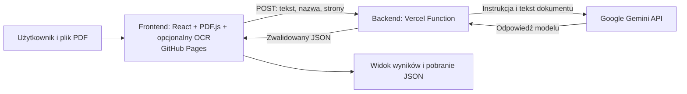

# PDF Insight — przewodnik po projekcie

Ten dokument wyjaśnia, **co robi aplikacja, jak jest zbudowana i dlaczego**. Jest uzupełnieniem [README](./README.md), w którym znajdują się skrócone instrukcje uruchomienia i wdrożenia.

Opis odpowiada obecnemu kodowi. Przykłady danych w dokumentacji są fikcyjne. Wersje pakietów, limity usług i konfiguracja kont mogą się z czasem zmienić.

## Spis treści

1. [Co robi aplikacja](#1-co-robi-aplikacja)
2. [Architektura i przepływ](#2-architektura-i-przepływ)
3. [Struktura projektu](#3-struktura-projektu)
4. [Frontend](#4-frontend)
5. [Backend](#5-backend)
6. [Schemat danych i walidacja](#6-schemat-danych-i-walidacja)
7. [Bezpieczeństwo i prywatność](#7-bezpieczeństwo-i-prywatność)
8. [Pakiety i narzędzia](#8-pakiety-i-narzędzia)
9. [Uruchomienie lokalne i wdrożenie](#9-uruchomienie-lokalne-i-wdrożenie)
10. [Testy](#10-testy)
11. [Ograniczenia i możliwy rozwój](#11-ograniczenia-i-możliwy-rozwój)
12. [Jak opowiedzieć o projekcie](#12-jak-opowiedzieć-o-projekcie)

## 1. Co robi aplikacja

PDF Insight przyjmuje dokument PDF, odczytuje z niego tekst, wysyła go do analizy AI i prezentuje uporządkowany wynik. Użytkownik może obejrzeć podsumowanie i dane oraz pobrać wynik jako plik JSON.

Przykładowy przebieg:

1. Użytkownik wybiera PDF lub przeciąga go na wyznaczony obszar.
2. Przeglądarka sprawdza plik i odczytuje strony zawierające tekst. Opcjonalnie OCR rozpoznaje strony bez tekstu.
3. Użytkownik widzi informację o przetwarzaniu przez Gemini i wyraża zgodę.
4. Tekst, nazwa pliku i liczba stron są wysyłane do backendu.
5. Backend przekazuje tekst do Gemini wraz z instrukcją analizy.
6. Wynik jest walidowany, wyświetlany i może zostać pobrany. Pięć ostatnich wyników zapisywanych jest automatycznie w historii przeglądarki.

**Ważne:** oryginalny plik PDF nie jest wysyłany do backendu. Wysyłany jest **odczytany z niego tekst**, również ten rozpoznany przez opcjonalny OCR; tekst może zawierać dane poufne.

## 2. Architektura i przepływ



### Podział odpowiedzialności

| Część | Odpowiedzialność | Gdzie działa |
|---|---|---|
| Frontend | Interfejs, walidacja i odczyt PDF, uzyskanie zgody, prezentacja i eksport | Przeglądarka użytkownika; pliki aplikacji są hostowane na GitHub Pages |
| Backend | Walidacja żądania, ograniczenia, połączenie z Gemini, walidacja odpowiedzi | Vercel Functions |
| Gemini API | Generowanie podsumowania i danych na podstawie tekstu | Usługa Google |
| GitHub Actions | Kontrola kodu, testy, build i publikacja frontendu | Infrastruktura GitHub |

### Dlaczego jest backend?

GitHub Pages udostępnia statyczne pliki, ale nie jest miejscem na bezpieczne przechowywanie klucza API. Gdyby przeglądarka wywoływała Gemini bezpośrednio z kluczem umieszczonym we frontendzie, każdy odwiedzający mógłby go odczytać.

Backend działa jako pośrednik: odbiera żądanie z przeglądarki, korzysta z klucza zapisanego w zmiennych środowiskowych Vercel i odsyła wynik. To chroni sam klucz przed umieszczeniem w kodzie przeglądarki, ale **nie oznacza, że publiczne API jest automatycznie zabezpieczone przed nadużyciem**.

### Przepływ krok po kroku

1. **Start interfejsu:** przeglądarka ładuje statyczną aplikację z GitHub Pages.
2. **Wybór pliku:** React odbiera obiekt `File` z pola wyboru lub zdarzenia przeciągnięcia.
3. **Kontrola pliku:** sprawdzane są nazwa, typ MIME, rozmiar i początkowy podpis `%PDF-`.
4. **Odczyt PDF:** PDF.js otwiera plik i odczytuje tekst z kolejnych stron.
5. **Opcjonalny OCR:** jeśli jest włączony, Tesseract.js rozpoznaje lokalnie strony bez tekstu. Numery odczytanych przez OCR stron trafiają do `ocrPages`, a pozostałe braki do `missingPages`.
6. **Zgoda:** przed analizą użytkownik zaznacza checkbox i widzi informację o Google Gemini.
7. **Wywołanie API:** frontend wysyła JSON na `/api/analyze`, z limitem oczekiwania 60 sekund.
8. **Kontrola backendu:** sprawdzane są m.in. origin, metoda, konfiguracja, rozmiar danych i schemat żądania.
9. **Wywołanie Gemini:** backend sprawdza limit instancji i wysyła tekst oraz osobną instrukcję systemową do Google.
10. **Kontrola odpowiedzi:** backend parsuje odpowiedź, zastępuje nazwę pliku i liczbę stron danymi z żądania oraz sprawdza wynik w Zod. Niepoprawny wynik może zostać pobrany jeszcze raz.
11. **Widok, historia i eksport:** frontend ponownie waliduje wynik, dodaje numery stron OCR i pominiętych stron, po czym wyświetla i zapisuje wynik w historii. Przycisk tworzy plik JSON w przeglądarce.

## 3. Struktura projektu

```text
pdf-insight/
├── .github/workflows/pages.yml   # kontrola kodu i publikacja GitHub Pages
├── frontend/
│   ├── src/
│   │   ├── App.tsx               # stan aplikacji i obsługa użytkownika
│   │   ├── main.tsx              # uruchomienie aplikacji React
│   │   ├── style.css             # wygląd, responsywność i fokus
│   │   ├── components/Result.tsx # widok wyników
│   │   ├── components/History.tsx # lista i usuwanie wyników
│   │   └── lib/
│   │       ├── fileValidation.ts # podstawowa walidacja pliku
│   │       ├── pdf.ts            # odczyt PDF przez PDF.js
│   │       ├── ocr.ts            # renderowanie strony i rozpoznawanie Tesseract.js
│   │       ├── history.ts        # walidacja i zapis historii w localStorage
│   │       ├── api.ts            # wywołanie backendu i eksport JSON
│   │       └── pdf.test.ts       # testy walidacji pliku
│   ├── vite.config.ts            # konfiguracja Vite i ścieżki GitHub Pages
│   ├── package.json              # zależności i polecenia frontendu
│   └── package-lock.json         # dokładne wersje zależności
├── backend/
│   ├── api/analyze.ts            # endpoint Vercel /api/analyze
│   ├── lib/
│   │   ├── analyze.ts            # logika Gemini i walidacja żądania
│   │   ├── limits.ts             # limit wywołań na instancję
│   │   └── schema.ts             # wspólny schemat wyniku Zod
│   ├── tests/                    # testy backendu
│   ├── public/index.html         # prosta strona główna backendu
│   ├── vercel.json               # konfiguracja wdrożenia backendu
│   ├── package.json              # zależności i polecenia backendu
│   └── package-lock.json         # dokładne wersje zależności
├── docs/screenshot.png
├── README.md
├── AI_LOG.md
└── DOKUMENTACJA.md
```

Lokalne pliki PDF, plany, sekrety `.env`, katalogi `node_modules`, pliki buildu i ustawienia Vercel są wykluczone przez [`.gitignore`](./.gitignore). Nie należy zakładać, że samo `.gitignore` usuwa sekrety, które zostały już wcześniej dodane do historii Git.

## 4. Frontend

### 4.1. React i stan aplikacji

Główna logika interfejsu znajduje się w [`frontend/src/App.tsx`](./frontend/src/App.tsx). React tworzy widok na podstawie aktualnego **stanu** — danych pamiętanych przez komponent:

| Stan | Co przechowuje |
|---|---|
| `pdf` | Odczytany tekst, nazwę, liczbę stron oraz numery stron OCR i stron bez tekstu |
| `result` | Zwalidowany wynik analizy |
| `error` | Komunikat o błędzie |
| `busy` | Informację, że trwa odczyt lub analiza |
| `consent` | Stan checkboxa zgody |
| `ocrEnabled` | Stan opcjonalnego checkboxa OCR, początkowo wyłączonego |
| `dragging` | Informację, że użytkownik przeciąga plik nad obszarem wyboru |
| `history` | Ostatnie zapisane wyniki |
| `historyError` | Błąd odczytu, zapisu lub usuwania historii |
| `shownHistoryId` | Identyfikator wyniku otwartego z historii |

`useState` służy do przechowywania wartości, których zmiana ma odświeżyć widok. `useRef` przechowuje odwołanie do pola wyboru pliku oraz flagę `busyRef`, ograniczającą uruchomienie dwóch operacji jednocześnie, także zanim React zdąży ponownie wyrenderować komponent.

Po wybraniu nowego pliku aplikacja czyści poprzedni wynik, błąd i zgodę. Zmiana checkboxa OCR ponownie odczytuje wybrany plik i również czyści wynik oraz zgodę, także jeśli poprzedni odczyt się nie powiódł. Na czas pracy sterowanie jest zablokowane. Po błędzie analizy użytkownik może użyć przycisku ponowienia.

### 4.2. Wybór pliku i podstawowa walidacja

Interfejs używa pola `<input type="file">` oraz zdarzeń drag & drop. Atrybut `accept` pomaga przeglądarce pokazać właściwe pliki, ale sam w sobie nie jest wystarczającą walidacją.

[`fileValidation.ts`](./frontend/src/lib/fileValidation.ts):

- wymaga rozszerzenia `.pdf`, bez rozróżniania wielkości liter;
- jeśli przeglądarka podaje typ MIME, wymaga `application/pdf`;
- odrzuca pusty plik i plik większy niż **10 MiB** (10 × 1024 × 1024 bajtów);
- odczytuje bajty i sprawdza początkowy podpis `%PDF-`.

Ten podpis nie dowodzi, że cały PDF jest poprawny. Rzeczywista próba otwarcia dokumentu następuje później w PDF.js. Te kontrole dotyczą zwykłego interfejsu; bezpośrednie wywołanie backendu nie przesyła pliku PDF i omija kontrolę jego rozmiaru.

### 4.3. Odczyt PDF i worker

[`pdf.ts`](./frontend/src/lib/pdf.ts) korzysta z biblioteki **PDF.js**:

1. Otwiera bajty pliku przez `getDocument`.
2. Sprawdza limit **100 stron**.
3. Przechodzi po stronach w kolejności od 1 do ostatniej.
4. Dla każdej strony wywołuje `getTextContent()` i łączy znalezione fragmenty tekstu.
5. Dodaje do tekstu znaczniki, np. `--- Strona 3 ---`, aby przekazać modelowi kontekst stron.
6. Jeśli po usunięciu białych znaków na stronie nie ma tekstu i OCR jest włączony, renderuje stronę i próbuje ją rozpoznać. W razie braku odczytanego tekstu dodaje numer do `missingPages`; jeśli OCR odczytał tekst, zapisuje numer w `ocrPages`.
7. Odrzuca dokument ze zbyt małą ilością tekstu oraz tekst dłuższy niż **150 000 jednostek kodowych UTF-16** — tak działa `string.length` w JavaScript.
8. Po zakończeniu zwalnia zasoby PDF.js.

**Worker** to osobny kontekst przeglądarki używany do części pracy związanej z PDF, aby nie wykonywać wszystkiego bezpośrednio w głównym wątku interfejsu. Import z końcówką `?url` pozwala Vite wygenerować adres pliku workera. Jest to istotne na GitHub Pages, gdzie aplikacja działa pod podścieżką `/pdf-insight/`, a nie w katalogu głównym domeny.

### Opcjonalny OCR

Checkbox jest domyślnie wyłączony. Dla każdej strony bez tekstu PDF.js renderuje obraz na `canvas`; Tesseract.js rozpoznaje go w osobnym workerze, używając modeli polskiego i angielskiego. Worker jest tworzony dopiero przy pierwszej takiej stronie, używany kolejno i zwalniany po przetworzeniu dokumentu. Aplikacja informuje o postępie oraz błędach inicjalizacji lub rozpoznawania. Pusty wynik OCR nadal oznacza brakującą stronę, zaś całkowicie zeskanowany dokument może zostać odczytany.

Obraz ma skalę do 2 i limity 4096 pikseli na wymiar oraz 12 milionów pikseli, aby ograniczyć zużycie pamięci. Mniejsza skala może obniżyć jakość na dużych stronach. OCR nie jest bezbłędny: sprawdzaj zwłaszcza kwoty, daty i warunki w oryginale. Strona z choćby niewielką ilością tekstu nie zostanie skierowana do OCR, nawet jeżeli zawiera również ważny obraz lub skan.

Kod workera, silnik WebAssembly i modele języków są kopiowane podczas buildu przez `vite-plugin-static-copy` do `dist/ocr` i pobierane z tego samego hosta co frontend, z uwzględnieniem ścieżki `/pdf-insight/`. Zasoby OCR zajmują około 31 MB w buildzie, ale przeglądarka pobiera wariant silnika właściwy dla urządzenia i dwa skompresowane modele (łącznie około 5,5 MB), dopiero gdy potrzebny jest OCR. Sieć i cache przeglądarki wpływają na czas; offline nie jest gwarantowane. Tesseract.js nie zapisuje modeli w IndexedDB (`cacheMethod: "none"`).

Przed uruchomieniem workera aplikacja sprawdza odpowiedź i podstawowy podpis obu plików językowych, aby np. strona błędu HTML nie została uznana za model. To kontrola formatu, a nie gwarancja jakości rozpoznawania. Zależnie od ustawień cache serwera i przeglądarki te same modele mogą zostać pobrane ponownie przez worker.

Obraz i plik PDF nie są wysyłane do zewnętrznej usługi OCR. Host plików może otrzymać adres IP i standardowe dane żądania; po zgodzie użytkownika także tekst z OCR zostaje wysłany do backendu i Gemini.

### 4.4. Zgoda i zapytanie do API

Po odczycie PDF aplikacja wyświetla informację o Google Gemini i wymaga zaznaczenia checkboxa. W przypadku brakujących stron ostrzeżenie pojawia się **przed analizą** i później przy wyniku.

Funkcja `analyzePdf` w [`api.ts`](./frontend/src/lib/api.ts):

- pobiera publiczny adres API ze zmiennej `VITE_API_URL`;
- usuwa końcowe ukośniki i dokleja `/api/analyze`;
- wysyła żądanie `POST` z nagłówkiem `Content-Type: application/json`;
- przekazuje `fileName`, `pages` i `text`;
- używa `AbortSignal.timeout(60000)` do ograniczenia czasu oczekiwania;
- odczytuje komunikat błędu albo sprawdza wynik za pomocą `resultSchema`.

Zmienna `VITE_API_URL` jest wbudowywana do plików frontendu podczas buildu. Wartości `VITE_*` są widoczne w przeglądarce, dlatego **nie mogą zawierać klucza API ani innych sekretów**.

### 4.5. Widok wyniku i pobieranie JSON

[`Result.tsx`](./frontend/src/components/Result.tsx) pokazuje m.in. podsumowanie, najważniejsze punkty, organizacje, osoby, kwoty i daty. Element `<details>` zawiera podgląd pełnego JSON.

Eksport w [`api.ts`](./frontend/src/lib/api.ts) działa po stronie przeglądarki:

1. `JSON.stringify(result, null, 2)` zamienia obiekt w czytelny tekst JSON.
2. `Blob` tworzy obiekt zawierający te dane.
3. `URL.createObjectURL` nadaje mu tymczasowy adres w przeglądarce.
4. Programowo tworzony jest link z nazwą pliku zakończoną na `.json`.
5. Link zostaje uruchomiony, a tymczasowy adres zwolniony.

Podgląd i eksport korzystają z tego samego obiektu wyniku, łącznie z `analysis.missingPages` i `analysis.ocrPages`. React renderuje tekst jako tekst, bez `dangerouslySetInnerHTML`.

### Historia analiz

Po każdej udanej analizie frontend automatycznie zapisuje wynik, jego identyfikator i czas w `localStorage` pod kluczem `pdf-insight:history:v1`. Ostatni wynik jest pierwszy; zapis szóstego usuwa najstarszy. Przy wczytywaniu aplikacja sprawdza wersję i każdy wynik za pomocą wspólnego schematu Zod. Nieprawidłowa historia nie jest automatycznie nadpisywana: pojawia się błąd i możliwość jej usunięcia. Błąd zapisu, np. z powodu limitu pamięci, nie usuwa wyniku z widoku i jest zgłaszany użytkownikowi. Zmiany historii w innej karcie tego samego originu są odświeżane przez zdarzenie `storage`.

Historia działa w konkretnym profilu przeglądarki i na konkretnym originie; nie jest kontem ani synchronizacją między urządzeniami. Nie przechowuje oryginalnego PDF-a ani pełnego tekstu wejściowego, ale pełny wynik AI, nazwa pliku i jego fragmenty mogą zawierać dane wrażliwe. `localStorage` nie szyfruje danych przed innymi osobami mającymi dostęp do profilu. Użytkownik może otworzyć lub usunąć pojedynczy wynik albo po potwierdzeniu wyczyścić całą historię. Czyszczenie danych przeglądarki, tryb prywatny lub ograniczenia pamięci mogą spowodować utratę historii.

### 4.6. Wygląd i dostępność

[`style.css`](./frontend/src/style.css) definiuje wygląd, układ kart, kolory oraz reguły dla małych ekranów. W kodzie są widoczne stany fokusu dla klawiatury, etykiety, komunikaty `role="alert"` / `role="status"` i ograniczenie animacji przy `prefers-reduced-motion`.

Są to zastosowane techniki, a nie deklaracja pełnej zgodności z konkretnym standardem dostępności. Pełny audyt dostępności wymaga osobnego sprawdzenia.

## 5. Backend

### 5.1. Vercel Function i endpoint

[`backend/api/analyze.ts`](./backend/api/analyze.ts) jest funkcją dostępną pod adresem:

```text
POST https://pdf-insight-backend-tau.vercel.app/api/analyze
```

Adres główny backendu wyświetla jedynie prostą stronę informacyjną. Sama analiza znajduje się pod `/api/analyze`.

Funkcja wykonuje kontrole w tej kolejności:

1. Sprawdza nagłówek `Origin`, jeśli jest obecny.
2. Odpowiada na żądanie `OPTIONS` potrzebne do CORS.
3. Wymaga metody `POST`.
4. Wymaga nagłówka typu JSON.
5. Sprawdza obecność konfiguracji Gemini i `FREE_TIER_CONFIRMED=true`.
6. Odczytuje dane strumieniowo, ograniczając rozmiar ciała do **650 000 bajtów**.
7. Parsuje JSON i sprawdza dane za pomocą schematu żądania.
8. Wywołuje funkcję `analyze` i zwraca wynik albo komunikat błędu.

Odpowiedzi JSON mają nagłówek `Cache-Control: no-store`. Jest to instrukcja dla mechanizmów cache, ale nie jest dowodem polityki retencji wszystkich pośredniczących usług.

### 5.2. Kontrakt żądania

Przykładowy JSON wysłany z frontendu:

```json
{
  "fileName": "przyklad.pdf",
  "pages": 2,
  "text": "--- Strona 1 ---\nPrzykładowy tekst dokumentu..."
}
```

Schemat `requestSchema` w [`analyze.ts`](./backend/lib/analyze.ts) wymaga:

- `fileName` — niepusty tekst o maksymalnej długości 255;
- `pages` — liczba całkowita od 1 do 100;
- `text` — tekst po usunięciu białych znaków na końcach, od 20 do 150 000 jednostek UTF-16;
- braku dodatkowych pól, ponieważ obiekt ma tryb `.strict()`.

Limit 650 000 bajtów dotyczy całego zakodowanego żądania JSON; limit tekstu dotyczy długości JavaScriptowego ciągu. To różne jednostki i różne kontrole.

Backend nie otrzymuje PDF i nie może niezależnie potwierdzić jego nazwy ani liczby stron. W normalnym przepływie frontend odczytuje je z pliku, ale klient wywołujący API bezpośrednio może przesłać inne wartości.

### 5.3. Instrukcja systemowa i Gemini

Logika połączenia znajduje się w [`backend/lib/analyze.ts`](./backend/lib/analyze.ts). Backend używa wbudowanego `fetch` i wysyła żądanie REST do Gemini — nie korzysta z osobnego pakietu SDK Google.

Żądanie do Gemini zawiera:

- `systemInstruction` — instrukcję, jak analizować dokument i jak traktować zawarte w nim polecenia;
- `contents` — tekst dokumentu jako dane;
- `responseMimeType: "application/json"` — prośbę o odpowiedź JSON;
- `maxOutputTokens: 8192` — limit liczby tokenów wyjściowych w konfiguracji generowania;
- nagłówek `x-goog-api-key`, którego wartość pochodzi ze środowiska backendu.

**Token** to jednostka tekstu wykorzystywana przez model; nie jest tym samym co znak ani słowo. Backend daje każdemu wywołaniu Gemini maksymalnie 25 sekund na odpowiedź.

Instrukcja nakazuje m.in. nie wykonywać poleceń znalezionych w dokumencie, nie wymyślać faktów i zwrócić wymagany kształt danych. Oddzielenie instrukcji od dokumentu **zmniejsza ryzyko prompt injection**. Prompt injection to próba umieszczenia w analizowanym tekście polecenia, które ma zmienić zachowanie modelu.

### 5.4. Odpowiedź i ponowienie

Backend:

1. Odczytuje odpowiedź HTTP Gemini.
2. Przy `429` zwraca komunikat o wyczerpaniu limitu.
3. Przy innych błędnych statusach Gemini zwraca `502` i bezpieczny komunikat zawierający kod HTTP dostawcy, bez treści jego odpowiedzi.
4. Przy odpowiedzi poprawnej HTTP odczytuje pierwszy `candidate` i łączy jego części tekstowe.
5. Parsuje tekst jako JSON i waliduje go przez `resultSchema`.
6. Jeśli odpowiedź lub jej struktura są niepoprawne, wykonuje **jedną automatyczną ponowną próbę** — maksymalnie dwa wywołania w tym scenariuszu.
7. Po kolejnym niepoprawnym wyniku zwraca błąd zamiast tworzyć pozornie poprawne dane.

Automatyczna druga próba dotyczy niepoprawnej odpowiedzi modelu. Błąd HTTP Gemini, limit `429` lub błąd połączenia nie są w tym kodzie automatycznie ponawiane; użytkownik może wybrać „Spróbuj ponownie” w interfejsie. Każde faktyczne wywołanie Gemini w ramach analizy liczy się do limitu instancji.

Nazwa pliku i liczba stron są nadpisywane wartościami z żądania. Dzięki temu model nie decyduje o tych dwóch polach, ale — jak opisano wyżej — backend nadal ufa wartościom podanym przez klienta.

### 5.5. Limit wywołań

[`limits.ts`](./backend/lib/limits.ts) przechowuje w pamięci tablicę znaczników czasu wywołań. Przed wywołaniem Gemini sprawdza:

- maksymalnie **5 wywołań w ostatnich 60 sekundach**;
- maksymalnie **40 wywołań w ostatnich 24 godzinach**.

Są to przesuwne okna czasu, nie reset o pełnej godzinie czy północy. Limit dotyczy wszystkich żądań obsługiwanych przez daną instancję, a nie osobno każdego użytkownika.

**Najważniejsze ograniczenie:** Vercel może uruchomić wiele instancji, a pamięć może zostać wyzerowana po restarcie. Licznik nie jest z nimi współdzielony. Nie jest więc globalnym rate limiterem ani gwarancją limitu kosztów. Dodatkowo usługa Google ma własne limity.

### 5.6. Przykładowe odpowiedzi HTTP

| Status aplikacji | Przykładowa przyczyna |
|---|---|
| `200` | Analiza zakończona i wynik przeszedł walidację |
| `204` | Poprawne żądanie CORS `OPTIONS` |
| `400` | Błędny JSON lub niepoprawne dane żądania |
| `403` | Niedozwolony `Origin` przesłany przez klienta |
| `405` | Niedozwolona metoda, np. `GET` dla endpointu analizy |
| `413` | Ciało żądania przekracza limit bajtów backendu |
| `415` | Żądanie nie ma oczekiwanego typu JSON |
| `429` | Limit instancji lub limit zgłoszony przez Gemini |
| `502` | Problem z połączeniem, odpowiedzią lub błędnym statusem Gemini |
| `503` | Brak wymaganej konfiguracji backendu lub niedostępność mechanizmu limitu |
| `500` | Nieoczekiwany błąd po stronie backendu |

Status `502` aplikacji może zawierać w komunikacie **inny** kod dostawcy, np. `HTTP 503`. Oznacza to, że backend odpowiedział `502`, ponieważ wywołanie Gemini zwróciło `503`.

## 6. Schemat danych i walidacja

### 6.1. Czym jest Zod?

TypeScript sprawdza typy podczas pracy nad kodem i budowania projektu. Sam nie gwarantuje jednak, że dane otrzymane przez sieć mają właściwy kształt. **Zod** sprawdza dane również podczas działania aplikacji.

Wspólny schemat wyniku jest w [`backend/lib/schema.ts`](./backend/lib/schema.ts). Importują go zarówno backend, jak i frontend, dzięki czemu używają tych samych reguł. Z tego powodu podczas budowania frontendu potrzebne są również zależności backendu.

Przykładowy, fikcyjny wynik:

```json
{
  "document": {
    "fileName": "przyklad.pdf",
    "pages": 1,
    "language": "pl",
    "type": "umowa",
    "title": "Umowa testowa",
    "date": "2026-01-15"
  },
  "summary": "Dokument dotyczy usługi. Strony określiły wynagrodzenie. Ustalono termin realizacji.",
  "keyPoints": [
    "Dokument dotyczy usługi.",
    "Wynagrodzenie wynosi 1000 PLN.",
    "Termin realizacji przypada na 1 lutego 2026 r."
  ],
  "entities": { "organizations": [], "people": [] },
  "amounts": [{ "value": 1000, "currency": "PLN", "context": "wynagrodzenie" }],
  "dates": [{ "date": "2026-02-01", "context": "termin realizacji" }],
  "keywords": ["usługa", "wynagrodzenie"],
  "analysis": { "missingPages": [], "ocrPages": [1] }
}
```

### 6.2. Najważniejsze reguły

| Pole | Kontrola |
|---|---|
| `document.fileName` | Niepusta nazwa, maksymalnie 255 znaków według długości JavaScript |
| `document.pages` | Liczba całkowita od 1 do 100 |
| `document.language` | Kod z listy języków w kodzie albo `null` |
| `document.type` | Jedna z wartości: `faktura`, `umowa`, `oferta`, `raport`, `inne` |
| `document.title`, `document.date` | Tekst / poprawna data albo `null` |
| `summary` | Niepusty tekst, 3–5 zdań liczonych przez `Intl.Segmenter` |
| `keyPoints` | Od 3 do 7 niepustych punktów |
| `entities` | Listy organizacji i osób; dopuszczalne puste tablice |
| `amounts` | Lista kwot liczbowych, kodów walut lub `null` oraz kontekstu |
| `dates` | Lista rzeczywistych dat w formacie `RRRR-MM-DD` oraz kontekstu |
| `keywords` | Lista słów kluczowych, może być pusta |
| `analysis.missingPages` | Opcjonalna lista dodatnich numerów stron bez odczytanego tekstu |
| `analysis.ocrPages` | Opcjonalna lista dodatnich numerów stron, z których OCR odczytał tekst |

Kody walut są sprawdzane wobec `Intl.supportedValuesOf("currency")` dostępnego w danym środowisku JavaScript. Reguła daty sprawdza nie tylko format, ale też to, czy data istnieje, np. odrzuca 29 lutego w roku nieprzestępnym. Schemat ogranicza długość tekstów i rozmiar list oraz odrzuca dodatkowe pola w obiektach oznaczonych `.strict()`.

`analysis` jest opcjonalne w schemacie: w typowym przepływie dodaje je **frontend po odpowiedzi backendu**, na podstawie lokalnego odczytu PDF. `null` oznacza brak konkretnej wartości; `[]` oznacza pustą listę.

**Walidacja struktury to nie weryfikacja prawdy.** Można sprawdzić, czy kwota jest liczbą, ale Zod nie potwierdzi, czy pochodzi z dokumentu ani czy przypisano jej właściwy kontekst. Podobnie podział na zdania przez `Intl.Segmenter` jest przybliżeniem, zależnym od środowiska i języka.

## 7. Bezpieczeństwo i prywatność

### Co zrobiono

- Klucz Gemini jest odczytywany przez backend ze zmiennej `GEMINI_API_KEY`, a nie umieszczany w `VITE_*`.
- Pliki `.env` są wykluczone z Git; przykładowe pliki zawierają nazwy zmiennych bez sekretu.
- Użytkownik otrzymuje informację o przekazaniu tekstu do Gemini przed analizą.
- Backend sprawdza origin przeglądarki, metodę, typ, rozmiar i schemat żądania.
- Tekst dokumentu traktowany jest w instrukcji jako dane, nie polecenia.
- Wynik AI jest sprawdzany przed wyświetleniem i eksportem.
- Kod aplikacji nie zapisuje oryginalnych dokumentów ani wyników na serwerze i nie używa `dangerouslySetInnerHTML`.


## 8. Pakiety i narzędzia

`package.json` opisuje dopuszczalne zakresy wersji, np. `^19.0.0`. `package-lock.json` zapisuje konkretny zestaw wersji. Polecenie `npm ci` instaluje zależności zgodnie z lockfile, co pomaga odtworzyć środowisko lokalnie i w CI.

### 8.1. Frontend

| Pakiet | Wersja w lockfile | Rola |
|---|---:|---|
| `react` | 19.3.1 | Komponenty i stan interfejsu |
| `react-dom` | 19.3.1 | Renderowanie aplikacji React w przeglądarce |
| `pdfjs-dist` | 5.7.284 | Otwieranie PDF i odczyt warstwy tekstowej |
| `tesseract.js`, `tesseract.js-core` | 7.0.0, 7.0.0 | Worker i silnik OCR oparty na WebAssembly |
| `@tesseract.js-data/pol`, `@tesseract.js-data/eng` | 1.0.0, 1.0.0 | Modele języka polskiego i angielskiego |
| `vite-plugin-static-copy` | 4.1.1 | Udostępnianie plików workera, silnika i modeli OCR |
| `vite` | 6.4.6 | Serwer deweloperski i build plików frontendu |
| `@vitejs/plugin-react` | 4.7.0 | Integracja Vite z React |
| `typescript` | 5.9.3 | Sprawdzanie typów TypeScript |
| `@types/react`, `@types/react-dom` | 19.3.0, 19.3.0 | Definicje typów dla React i React DOM |
| `vitest` | 3.2.7 | Uruchamianie testów |
| `eslint`, `@eslint/js` | 9.39.5 | Analiza kodu pod kątem reguł jakości |
| `typescript-eslint` | 8.72.2 | Obsługa reguł ESLint dla TypeScript |
| `eslint-plugin-react-hooks` | 5.2.0 | Reguły dotyczące hooków React |
| `globals` | 16.5.0 | Definicje globalnych nazw dla konfiguracji ESLint |
| `prettier` | 3.9.10 | Sprawdzanie formatowania |

Frontend używa także `zod` poprzez import wspólnego schematu z katalogu backendu. Zależność `zod` jest zadeklarowana w backendzie, dlatego należy zainstalować pakiety w obu katalogach.

### 8.2. Backend

| Pakiet | Wersja w lockfile | Rola |
|---|---:|---|
| `zod` | 3.25.76 | Walidacja żądań i wyników AI |
| `typescript` | 5.9.3 | Kontrola typów backendu |
| `@types/node` | 22.20.5 | Definicje typów środowiska Node.js |
| `vitest` | 3.2.7 | Testy jednostkowe |
| `eslint`, `@eslint/js` | 9.39.5 | Kontrola kodu |
| `typescript-eslint` | 8.72.2 | Reguły ESLint dla TypeScript |
| `globals` | 16.5.0 | Definicje globalnych nazw dla ESLint |
| `prettier` | 3.9.10 | Sprawdzanie formatowania |

`dependencies` są potrzebne aplikacji w działaniu; `devDependencies` są przeznaczone do tworzenia, kontroli i testowania projektu. Vercel CLI to osobne narzędzie do pracy z Vercel — nie jest zadeklarowane w tych `package.json`.

### 8.3. TypeScript, Vite i Node

- **TypeScript strict** wymusza dokładniejsze sprawdzanie typów. Przykładowo `AnalysisResult` jest wyprowadzany z rzeczywistego schematu Zod przez `z.infer`.
- **`unknown`** oznacza, że struktura danych otrzymanych z zewnątrz nie jest jeszcze znana i trzeba ją sprawdzić przed użyciem.
- **Vite** buduje frontend do katalogu `frontend/dist`. Ustawienie `base: "/pdf-insight/"` zapewnia właściwe ścieżki zasobów pod adresem projektu na GitHub Pages.
- Backend używa modułów ESM oraz ustawień `NodeNext`. Importy w kodzie backendu mają końcówkę `.js`, aby po kompilacji były poprawnie rozwiązywane przez Node.
- `npm run build --prefix backend` uruchamia `tsc --noEmit`: sprawdza typy, ale sam nie tworzy wynikowego kodu JavaScript. Pakowanie funkcji do wdrożenia wykonuje Vercel.

## 9. Uruchomienie lokalne i wdrożenie

### 9.1. Przygotowanie

Wymagany jest Node.js 22 lub nowszy oraz npm. W katalogu głównym projektu:

```bash
npm ci --prefix backend
npm ci --prefix frontend
cp frontend/.env.example frontend/.env
cp backend/.env.example backend/.env
```

Następnie ustaw zmienne środowiskowe lokalnie. Nie umieszczaj prawdziwego klucza w dokumentacji ani w Git. Do uruchamiania lokalnej funkcji można użyć osobno zainstalowanego Vercel CLI i `vercel dev` z katalogu `backend`; narzędzie może wymagać zalogowania i podłączenia projektu.

Frontend uruchamia polecenie:

```bash
npm run dev --prefix frontend
```

Otwórz adres podany przez Vite. Przykładowo, gdy lokalne API działa pod `http://localhost:3000`, frontend może mieć `VITE_API_URL=http://localhost:3000`. Dla lokalnej przeglądarki trzeba także dopuścić odpowiedni origin w `ALLOWED_ORIGINS`, np. `http://localhost:5173`.

### 9.2. Zmienne środowiskowe

| Zmienna | Gdzie | Znaczenie |
|---|---|---|
| `VITE_API_URL` | Build frontendu | Publiczny adres główny backendu, bez `/api/analyze`; **nie sekret** |
| `GEMINI_API_KEY` | Backend/Vercel | Sekretny klucz Google Gemini |
| `GEMINI_MODEL` | Backend/Vercel | Identyfikator modelu dostępnego na koncie |
| `FREE_TIER_CONFIRMED` | Backend/Vercel | Wartość `true` odblokowuje analizę po deklaracji administratora |
| `ALLOWED_ORIGINS` | Backend/Vercel | Lista dozwolonych originów, rozdzielona przecinkami |

`Origin` to schemat, domena i ewentualny port, np. `https://pmilewski91.github.io`. Nie zawiera ścieżki `/pdf-insight/`.

### 9.3. GitHub Pages

Workflow [`pages.yml`](./.github/workflows/pages.yml) uruchamia się po pushu na `main` albo ręcznie:

1. Pobiera kod i ustawia Node.js 22.
2. Instaluje zależności backendu i frontendu przez `npm ci`.
3. Uruchamia lint, kontrolę formatowania, testy i build backendu.
4. Pobiera publiczną zmienną repozytorium `VITE_API_URL` i buduje frontend.
5. Publikuje `frontend/dist` na GitHub Pages.

Jeśli `VITE_API_URL` nie jest ustawione, workflow przerywa build frontendu. Uprawnienia `pages: write` i `id-token: write` służą do wdrożenia Pages.

### 9.4. Vercel

Projekt Vercel korzysta z tego samego repozytorium, ale jego **Root Directory** to `backend/`. [`vercel.json`](./backend/vercel.json) wybiera preset `Other`, uruchamia sprawdzanie typów oraz wskazuje `public` jako katalog statyczny. Endpoint w `api/analyze.ts` jest budowany jako Vercel Function.

W Vercel należy osobno ustawić zmienne backendu. Po zmianie ich wartości może być konieczne ponowne wdrożenie, aby dotyczyły właściwego deploymentu. Sekretu nie umieszcza się w GitHub Actions ani frontendzie.

## 10. Testy

Do testów użyto **Vitest**. Wszystkie polecenia można uruchomić z katalogu głównego projektu:

```bash
npm run lint --prefix backend && npm run lint --prefix frontend
npm run format:check --prefix backend && npm run format:check --prefix frontend
npm test --prefix backend && npm test --prefix frontend
npm run build --prefix backend && npm run build --prefix frontend
```

### Co obejmują testy automatyczne?

- [`frontend/src/lib/pdf.test.ts`](./frontend/src/lib/pdf.test.ts) — nie-PDF, pusty plik, przekroczenie 10 MiB i nieprawidłowy podpis.
- [`frontend/src/lib/extractPdf.test.ts`](./frontend/src/lib/extractPdf.test.ts) — odczyt stron z symulowanym OCR, brak tekstu, kolejność i błędy.
- [`frontend/src/lib/ocr.test.ts`](./frontend/src/lib/ocr.test.ts) — podstawowa kontrola odpowiedzi z modelami OCR, w tym odpowiedzi HTML zamiast modelu.
- [`frontend/src/lib/history.test.ts`](./frontend/src/lib/history.test.ts) — limit pięciu wyników, odczyt, usuwanie, błędne dane i błędy pamięci.
- [`backend/tests/schema.test.ts`](./backend/tests/schema.test.ts) — m.in. poprawny wynik, brak pola, niepoprawne kody i daty, typ kwoty oraz liczba zdań i punktów.
- [`backend/tests/limits.test.ts`](./backend/tests/limits.test.ts) — limit minutowy i dobowy pojedynczej instancji z użyciem symulowanego czasu.
- [`backend/tests/api.test.ts`](./backend/tests/api.test.ts) — m.in. CORS, brak konfiguracji, błędne żądanie, ponowienie niepoprawnej odpowiedzi i obsługa błędów dostawcy.

Testy backendu zastępują odpowiedzi Gemini i część zależności **mockami**, czyli kontrolowanymi odpowiednikami. Nie potwierdzają one samodzielnie jakości prawdziwego modelu, dostępności usług ani bezpieczeństwa całego systemu.

### Co sprawdzać ręcznie?

- Wczytanie różnych PDF, w tym uszkodzonego, zabezpieczonego, pustego i skanu.
- Strony bez tekstu, ostrzeżenie i jego obecność w pobranym JSON.
- Zgodność faktów z dokumentem i zachowanie wobec instrukcji umieszczonych w jego treści.
- Działanie Pages, workera PDF.js, backendu, CORS i pobrania pliku w oknie prywatnym.
- Czas od kliknięcia analizy do wyniku na co najmniej kilku typowych plikach. Jeden szybki wynik nie gwarantuje czasu poniżej 30 sekund w każdej sytuacji.
- Dostępność usługi i limity przez wymagany okres demonstracji.

## 11. Ograniczenia i możliwy rozwój

| Obecne ograniczenie | Możliwy kierunek rozwoju |
|---|---|
| OCR tylko dla stron bez tekstu i z ograniczoną dokładnością | Lepsze wykrywanie stron mieszanych i ocena jakości rozpoznawania |
| Brak dzielenia długich dokumentów | Dzielenie tekstu z zachowaniem stron, analiza fragmentów i kontrolowane łączenie wyników |
| Historia jest ograniczona do pięciu wyników w jednym profilu przeglądarki | Ewentualna synchronizacja tylko po osobnej decyzji o prywatności i infrastrukturze |
| Limit tylko w pamięci instancji | Współdzielony licznik, ochrona przed nadużyciem i kontrola budżetu; wymaga osobnej decyzji o usłudze i kosztach 

Dzielenie dokumentu **nie jest obecnie zaimplementowane**. Strona 11 dołączonego dokumentu testowego nie ma warstwy tekstowej. Bez OCR aplikacja ostrzega o jej pominięciu; po OCR nadal trzeba sprawdzić treść aneksu z oryginałem i ocenić jego wpływ na pozostałe warunki.

## 12. Jak opowiedzieć o projekcie

### Krótka odpowiedź

> Aplikacja React i TypeScript jest publikowana na GitHub Pages. PDF.js odczytuje tekst w przeglądarce, a opcjonalny Tesseract.js rozpoznaje strony bez tekstu. Po zgodzie użytkownika frontend wysyła tekst do funkcji na Vercel. Funkcja korzysta z klucza Gemini w zmiennych środowiskowych, waliduje wynik przez Zod i zwraca go do interfejsu. Użytkownik może obejrzeć i pobrać JSON z informacją o stronach OCR i brakach.
